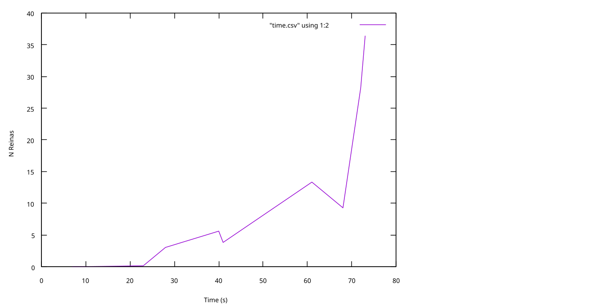

# Práctica 1 - SSII

Angel Ruiz Fernandez

Yingxuan Wang

### Índice

 - A. Explicacion algoritmo genetico
   - A.1. Elementos
   - A.2. Representación
     - A.2.1. Codificación
     - A.2.2. Operadores genéticos
     - A.2.3. Algoritmo genético
   - A.3. Proceso
 - B. Analiss
 - C. Manual de Asignación
 - E. Analisis del comportamiento global del SI basado en AG con respecto 4 criterios
   - E.1. Completitud
   - E.2. Optimalidad
   - E.3. Complejidad en tiempo
   - E.4. Complejidad en memoria

## A. Explicacion algoritmo genetico

### A.1. Elementos

 - **Representación**: cómo mediante simbolos, el algoritmo entiende la información
 correspondiente al mundo real o espacio de la solución
 - **Operadores**: cambian el estado, mediante ellos se llega a la solución. algunos
 pasos se acercan a la solución y otros se alejan
 - **Estrategia** del control: cuando aplicar que operadores, de manera que nominalmente
 se encamine hacia una solución

### A.2. Representación

#### A.2.1. Codificación

Representación del estado, o cromosoma.

Dependiendo del problema se usan distintos tipos de elemento (gen): binario, entero, real, orden...

#### A.2.2. Operadores genéticos

 - **Selección**: escoge que individuos van a reproducirse y cuales no
   - **Ruleta**: probabilidad de ser seleccionado proporcional a su función idoneidad
   - **Torneo**: se celebran n torneos de parejas de individuos donde ganan por idoneidad
 - **Cruce**: el acto de combinar los cromosomas para producir descendencia
   - Por punto
   - Por dos puntos
 - **Mutación**: con cierta probabilidad, el cromosoma varía de cierta manera
   - Cambio de gen aleatorio (bit flip)
   - Intercambio de genes

#### A.2.3. Algoritmo genético

 - Seleccionar k elementos
 - De ellos, con probabilidad P_c se cruzan individuos, la descendencia reemplaza a los padres
 - Con probabilidad P_m, se muta cualquiera de los individuos

### A.3. Proceso

Diseño y construcción de un algoritmo genético

 1. Diseñar una representación apropiada para el espacio de soluciones
 2. Decidir cómo inicializar una población. Uniforme para cubrir todos los máximos locales, o heurística previa
 3. Diseñar una correspondencia entre genotipo y fenotipo. A veces la correspondencia es directa; otras el genotipo es la entrada de algún algoritmo clásico que genera la solución final.
 4. Diseñar una forma de evaluar un individuo. Función de idoneidad (fitness) que distinga los genotipos mas adaptados y menos.
 5. Decidir cómo seleccionar los individuos para ser padres. Situar la linea entre los que se reproducen y los que no.
 6. Diseñar un operador de cruce adecuado. Intensificar. Probabilidad alta (0.6 < P_c < 0.9), debe hacer heredar características de los padres, no crear otras nuevas.
 7. Diseñar un operador de mutación adecuado. Diversificar. Probabilidad baja (P_m), lo suficientemente significativa como para alcanzar todo el espacio de busqueda.
 8. Decidir la condición de parada. Determinada por una función que comprueba si se ha llegado a una solución (óptima?).

## B. Analisis

De 41 hasta 70 reinas la probabilidad de mutación de 0.05 a 0.0.25 anterior es
demasiado para asegurar una solución. Entonces en este nuevo estudio se añaden
columnas de 0.01375 y 0.0125, en las que aparecen mas soluciones a lo largo do todo
la dimensión de N de reinas.

Elegimos 0.0125 de Pm para N reinas de 9 a 60, y 0.01375 para 61, y vuelta a 0.0125 de 62 a 70. Porque
así se evitan las instancias donde el algoritmo genético no llega a una solución
satisfactoria, y se reduce Pm para que tarde menos en llegarse a una solución.

## C. Manual de Asignación

 - Parametro 1: \<N de reinas\>
 - Parametro 2: 100
 - Parametro 3: 10000
 - Parametro 4: TOUR
 - Parametro 5: ONEP
 - Parametro 6: FLIP
 - Parametro 7: 0.85
 - Parametro 8: para N reinas
   - <= 8: 0.05
   - \[9, 28\]: 0.025
   - \[29, 61\]: 0.01375
   - \[62, 70\]: 0.0125

## D. Validación

Casos de validación

Ejecución: `./nreinas <N reinas> <2> <3> <4> <5> <6> <7> <8>`

| N reinas | 2 | 3 | 4 | 5 | 6 | 7 | 8 | jaques |
|----------|---|---|---|---|---|---|---|--------|
| 7 | 100 | 10000 | TOUR | ONEP | FLIP | 0.85 | 0.05 | 0 |
| 8 | 100 | 10000 | TOUR | ONEP | FLIP | 0.85 | 0.05 | 0 |
| 23 | 100 | 10000 | TOUR | ONEP | FLIP | 0.85 | 0.025 | 0 |
| 28 | 100 | 10000 | TOUR | ONEP | FLIP | 0.85 | 0.025 | 0 |
| 40 | 100 | 10000 | TOUR | ONEP | FLIP | 0.85 | 0.01375 | 0 |
| 41 | 100 | 10000 | TOUR | ONEP | FLIP | 0.85 | 0.01375 | 0 |
| 61 | 100 | 10000 | TOUR | ONEP | FLIP | 0.85 | 0.01375 | 0 |
| 68 | 100 | 10000 | TOUR | ONEP | FLIP | 0.85 | 0.0125 | 0 |
| 72 | 100 | 10000 | TOUR | ONEP | FLIP | 0.85 | 0.0125 | 0 |
| 73 | 100 | 10000 | TOUR | ONEP | FLIP | 0.85 | 0.0125 | 0 |

Para los anteriores casos de validación se obtiene un resultado favorable

## E. Analisis del comportamiento global del SI basado en AG con respecto 4 criterios

### E.1. Completitud

Si se sigue el manual de asignación correctamente, si, es completo

### E.2. Optimalidad

El problema no es de optimización, mientras que haya 0 jaques, dos soluciones son igualmente optimas

### E.3. Complejidad en tiempo

| N reinas | tiempo (s) |
|----------|------------|
| 7        | 0m0.011s |
| 8        | 0m0.006s |
| 23       | 0m0.042s |
| 28       | 0m0.877s |
| 40       | 0m2.182s |
| 41       | 0m0.571s |
| 61       | 0m5.676s |
| 68       | 0m4.077s |
| 72       | 0m12.294s |
| 73       | 0m15.975s |

### E.4. Complejidad en memoria

Fijo, ya que el tamaño de la población es siempre 100

