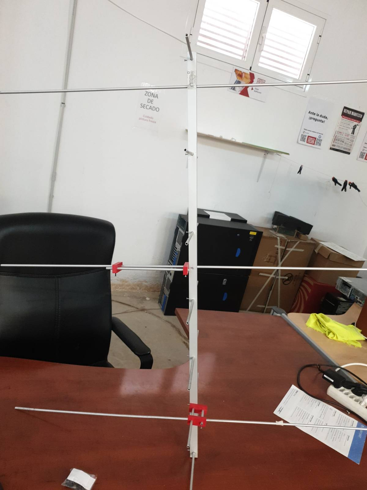
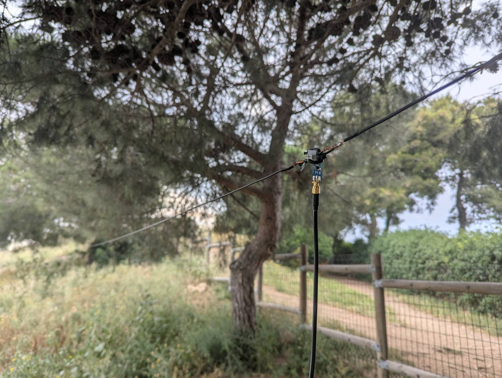
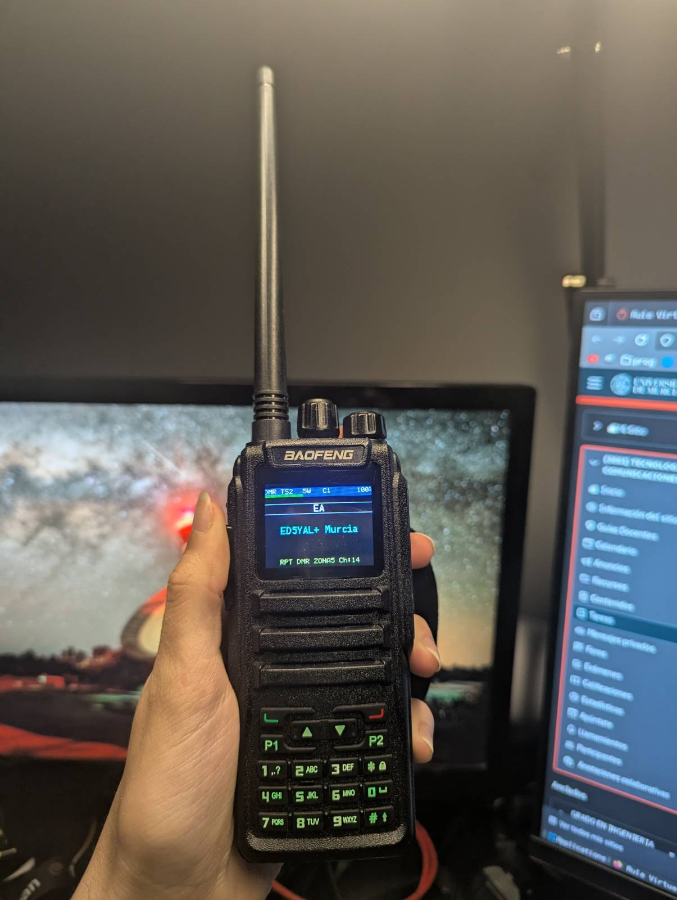
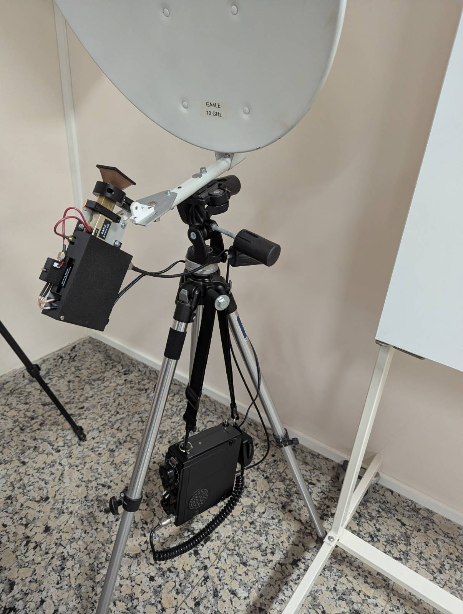
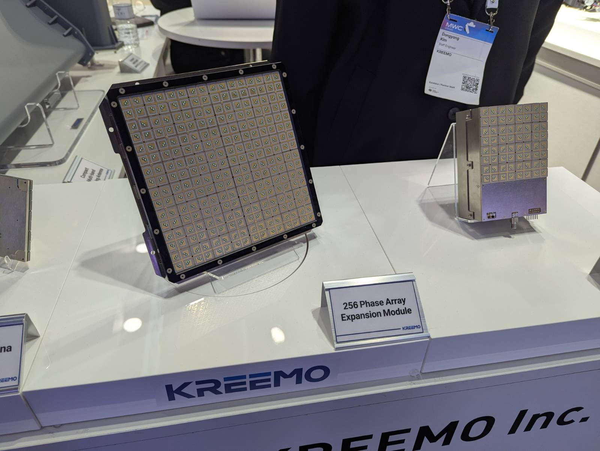
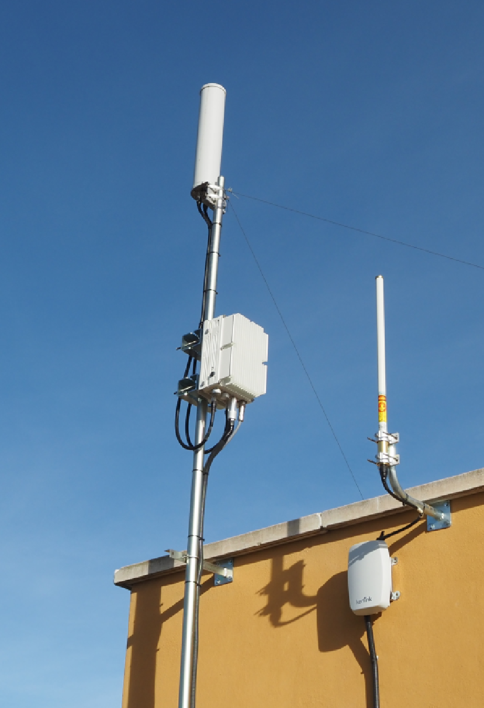

# Tarea de identificación de Antenas

## 1

Esta antena consiste en dos antenas Yagi-Uda, slapadas sobre el mismo boom y perpendiculares en este.
Se utiliza para la comunicación satelital en bandas de radioaficionado de 2m y 70cm, gracias a su alta
ganancia y directividad.

## 2

Esta antena es el tipo mas simple que hay, un dipolo. Este es para la banda de radioaficionados de 20m,
usada para comunicaciones a grandes distancias, casi omnidireccional, utilizando la propagación ionosférica.

## 3

Esto es una antena whip, un monopolo, utilizado en radios portátiles porque son omnidireccionales y
el cuerpo actua de tierra.

## 4

Esto combina dos tipos de antena, una parabólica offset de 60cm combinada con un
feed horn para 10GHz. Sirve para hacer contactos mediante el satélite QO100 en la
banda de 3cm.

## 5

Esto es un array enfasado. Sirve para tener una ganancia y directividad de una
antena directiva, sin necesidad de partes móviles para dirigirla.

## 6

Antena omnidireccional para 5G en el edificio Luis Vives. No permite el beamforming como otras.

Ángel Ruiz Fernandez

