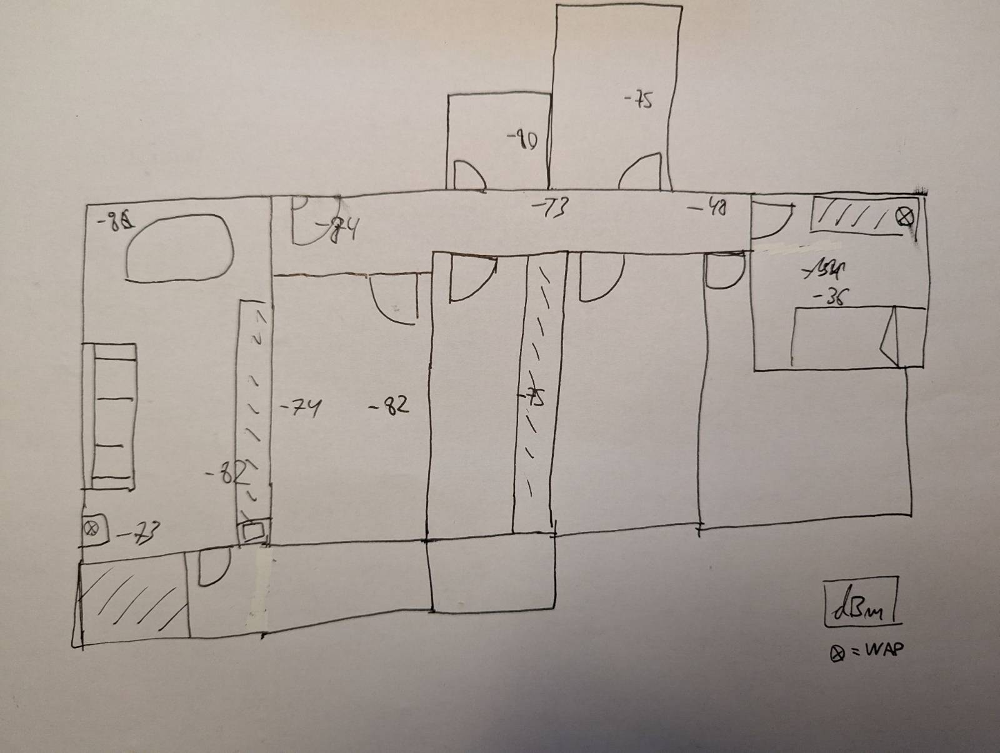

# Mapa de cobertura del entorno doméstico

## Equipamiento

 - UE: Móvil Pixel 7 con antena patch
 - CPE: Router Movistar con antenas whip internas

## Gráfico

## Condiciones

Solo presente el operario, siempre mirando al WAP, a las 22 de la noche.

## Velocidad de transmisión

 - Comedor 170mbps
 - Habitación 200mbps
 - Baño pequeño 110mbps

## Conclusiones

Hay dos WAPs sirviendo el mismo SSID y el movil solo coge uno, el de la habitación.

