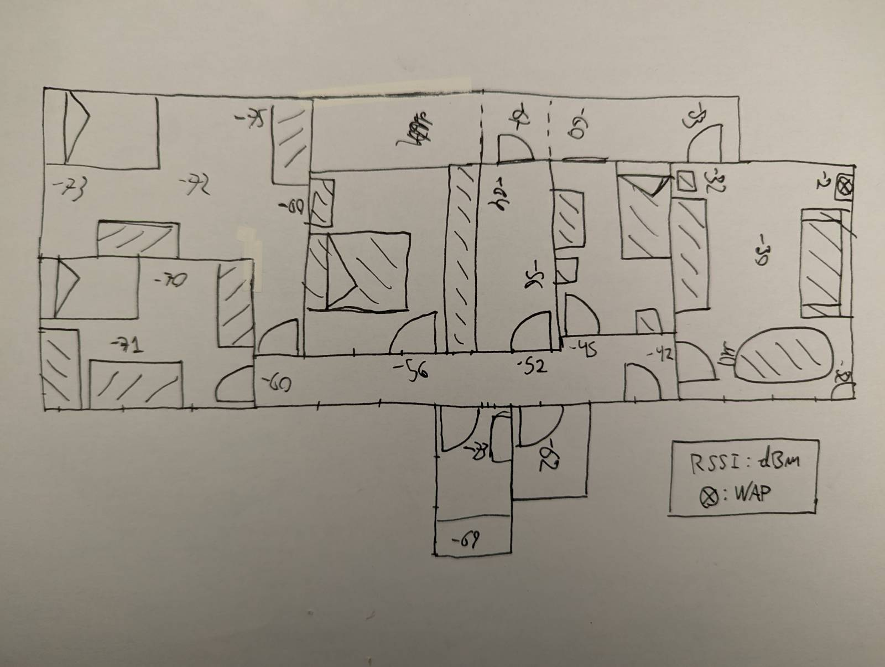

# Mapa de cobertura del entorno doméstico

## Equipamiento

 - UE: ThinkPad X230 con coreboot y Debian 13, tarjeta WiFi mini-PCIe Intel Centrino Advanced-N 6205 802.11a/b/g/n,
 2 antenas patch en la pantalla conectadas por RG-174 y conectores U.FL
 - CPE: Router Movistar Router Smart WiFi 6 Go Askey RTF8225VW

## Gráfico

## Condiciones

En canal 5880MHz @40MHz Ch.175

Software: iw en linux, driver: iwlwifi

Test de velocidad: iperf3 a un servidor conectado por ethernet al router

Solo presente el tester, siempre mirando al WAP, a las 22 de la noche.

## Velocidad de transmisión

 - Comedor 230mbps
 - Habitación 60mbps
 - Baño pequeño 110mbps

## Conclusiones

Hay un WAP sirviendo el SSID, en la esquina del comedor. La velocidad, no llega
al maximo que permiten los estandares en ningún caso, y se corresponde mas o menos
con el RSSI.

El setup wireless actual de este piso de estudiantes es algo inadecuado. Habría que
poner otro WAP en el lado opuesto del piso, conectado por cable.

